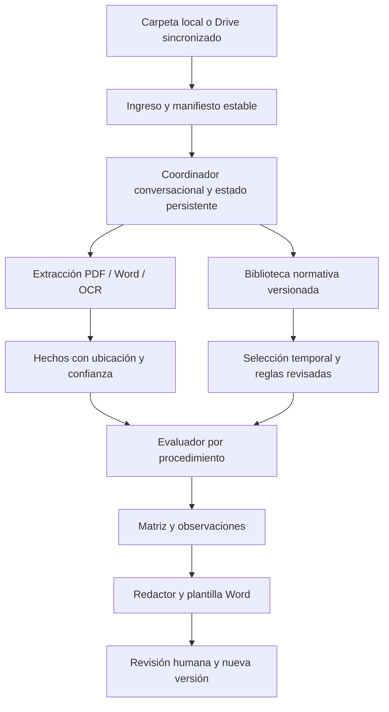

# Plan integral de OECE Assistant
Fecha de referencia: 2026-10-29, America/Lima. Estado actualizado 31/10/2026: versión asistida v1 disponible en Codex con panel y herramientas locales. El plan amplio de automatización conserva pendientes explícitos. [Estado actual por fase](ESTADO.md).

## Resultado esperado
El usuario indica “este proveedor quiere ampliar su categoría; revisa esta carpeta y prepara el informe”. El coordinador identifica el expediente y el trámite, pide solo datos faltantes, selecciona la normativa aplicable a las fechas relevantes y coordina extracción, evaluación y redacción. Entrega borrador Word editable, matriz de evidencias, observaciones y registro de versiones para revisión humana. No firma ni presenta documentos ante OECE.

## Alcance modular
1. Ampliación de categorías de consultores de obras (primer piloto).
2. Aumento de capacidad máxima de contratación de ejecutores de obras.
3. Inscripción y reinscripción: distinguir tipo de proveedor, persona natural/jurídica, nacional/extranjera y domicilio.
4. Actualización legal y financiera; actualización técnica mediante el procedimiento correspondiente.
5. Reconsideraciones: vincular acto previo, notificación, prueba y argumentos; no confundir con apelación ni generar nuevas conclusiones sin revisar el expediente previo.

Cada módulo tendrá ficha del procedimiento, reglas versionadas, documentos esperados, matriz, plantilla y casos de aceptación. Las categorías no se codificarán a partir de esquemas históricos sin verificar régimen y fecha.

## Arquitectura propuesta

Los roles normativo, documental, evaluador y redactor son responsabilidades lógicas; no requieren varios agentes autónomos en el piloto. El coordinador invoca herramientas con contratos de datos y permisos limitados. Los cálculos y fechas deben ser reproducibles; el modelo sirve para diálogo, clasificación asistida y redacción fundada.

### Ingreso y activación
- Carpeta privada por expediente con ID opaco. Subcarpetas entrada, subsanaciones, derivados, salida y auditoría.
- Iniciar al detectar carga completa: archivo de cierre/listo o manifiesto estable; verificar tamaño y hash antes de encolar. Esperar descargas incompletas y archivos solo en la nube.
- Duplicados por hash; concurrencia con bloqueo por expediente; reintentos acotados e idempotentes. Renombrar un archivo no crea otra evidencia.
- Google Drive sincronizado se trata como carpeta local. No implica integración API ni acceso automático a todo Drive.
- Una incorporación posterior crea nueva revisión, conserva la anterior y marca resultados afectados. No sobrescribir originales ni informes aprobados.

### Estado y conversación
Estados propuestos: recibido → esperando_archivos → extrayendo → requiere_datos → evaluando → borrador → revision_humana → cerrado; error recuperable con motivo.
Persistir transiciones, preguntas, respuestas y referencias al manifiesto. Reiniciar no debe perder una conversación ni repetir salidas. Preguntar por procedimiento, fecha de solicitud y alcance solo cuando no se puedan establecer con evidencia. Declaraciones del usuario y hechos documentales tienen procedencia distinta.

### Lectura documental
PDF con texto primero; OCR solo en páginas sin extracción suficiente. Word: párrafos, tablas, encabezados y anexos; imágenes conservadas como evidencia. Registrar motor y versión, idioma, página o bloque, texto, confianza y advertencias. DOC antiguo requerirá conversión controlada; DOCX no ejecutará macros ni vínculos. Texto ilegible, tablas ambiguas y contradicciones pasan a revisión humana.

### Biblioteca y evaluación
Guardar originales inmutables fuera de Git y metadatos públicos en Git. Recuperación por procedimiento, disposición, fecha y estado de revisión; búsqueda textual inicial y semántica opcional. Nunca mezclar versiones en una respuesta. Conservar relaciones modifica/deroga/aprueba/corrige y separar texto original, consolidación oficial e interpretación interna.
Cada regla produce cumple / no_cumple / no_determinable / no_aplica con hechos, fuente, operación y motivo. Una ausencia documental no prueba automáticamente incumplimiento sustantivo. Regla no validada, vigencia incierta o evidencia insuficiente impiden conclusión definitiva.

### Redacción y entregables
Word: identificación, objeto, antecedentes cronológicos, documentos revisados, base normativa aplicable, análisis por requisito, observaciones, conclusión propuesta y anexos. Mostrar estado “BORRADOR PARA REVISIÓN”, versión del expediente y fecha de corte normativo.
Matriz exportable y manifiesto acompañan al Word. Todas las afirmaciones materiales deben enlazar a evidencia documental y norma; faltantes visibles, sin completar con datos supuestos.

### Decisiones técnicas
Decisión de v1: Python para herramientas locales, panel web en 127.0.0.1 y Codex como coordinador conversacional del proyecto mediante AGENTS.md. No se integra un nuevo modelo autónomo en el panel; el archivo LISTO activa preparación documental local, y el análisis abierto se completa conversando en Codex. Se puede seguir trabajando sin configurar una API nueva. Una arquitectura autónoma independiente sigue siendo alcance posterior, no implementación comprobada. Se conserva la base Python existente; la guía de agentes permite mantener una pila ya establecida. Eve no se instaló ni se presenta como parte del runtime. No hay compromiso de despliegue en Vercel ni necesidad establecida de nube. Evaluar coste por expediente, límites de contexto, funcionamiento sin conexión, compatibilidad Windows y tratamiento de datos antes de elegir.
No añadir una base vectorial ni múltiples agentes hasta demostrar necesidad con el conjunto de evaluación.

## Organización
Git: docs/, normativa/ (metadatos), schemas/, y posteriormente src/, rules/, templates/ sin datos personales, tests/ con casos sintéticos.
Almacenamiento privado externo: biblioteca/originales, biblioteca/extraidos, expedientes/<id>, plantillas institucionales autorizadas y salidas. Los índices y embeddings derivados de expedientes también son privados.
El directorio de trabajo actual está bajo OneDrive: cualquier documento real allí podría sincronizarse. Definir una raíz privada autorizada antes del piloto.

## Gobierno y continuidad
Responsable funcional: especialista revisor designado por el usuario. Responsable técnico: mantenedor del proyecto. Una norma nueva abre revisión de impacto y suspende las reglas afectadas hasta aprobación. Cada sesión retoma ROADMAP y TAREAS, registra cambios y evidencia, sin depender del historial del chat.
No inferir facultades institucionales desde la convocatoria laboral. Obtener después ejemplos anonimizados, plantilla autorizada y criterios internos formalizados.
